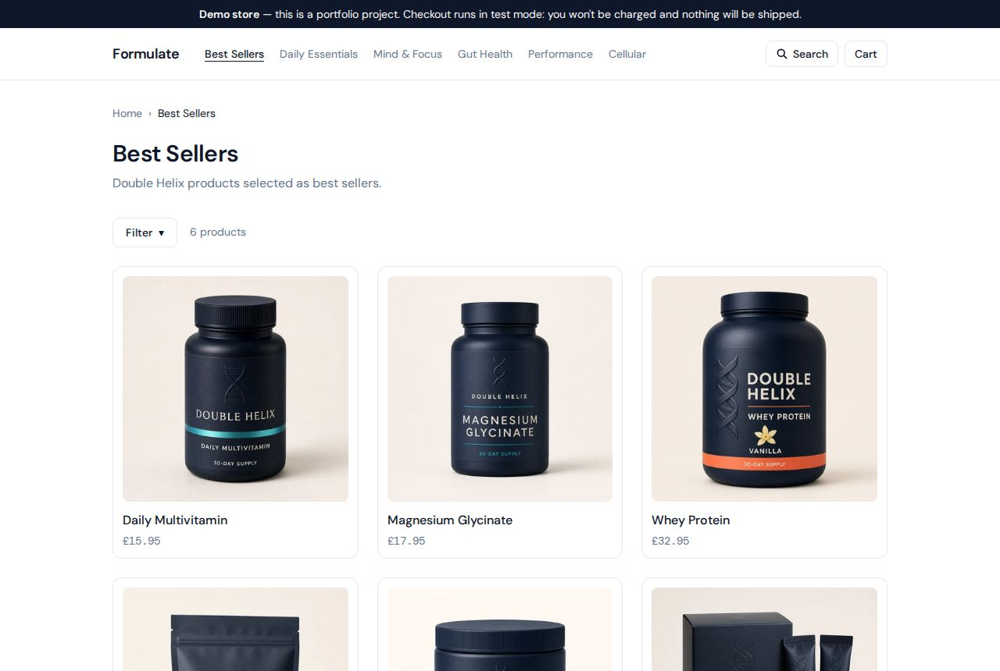
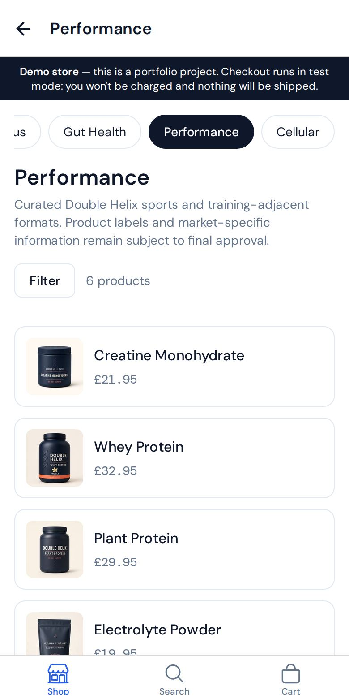
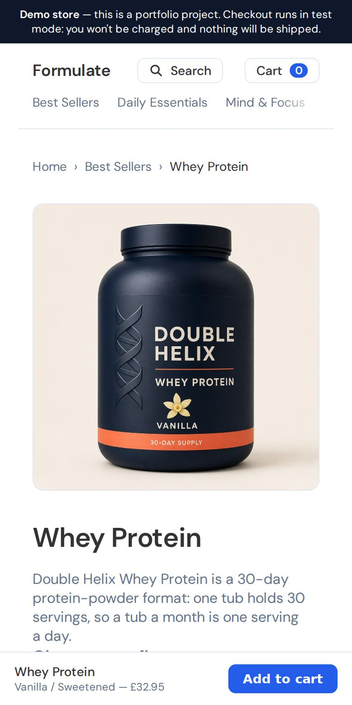
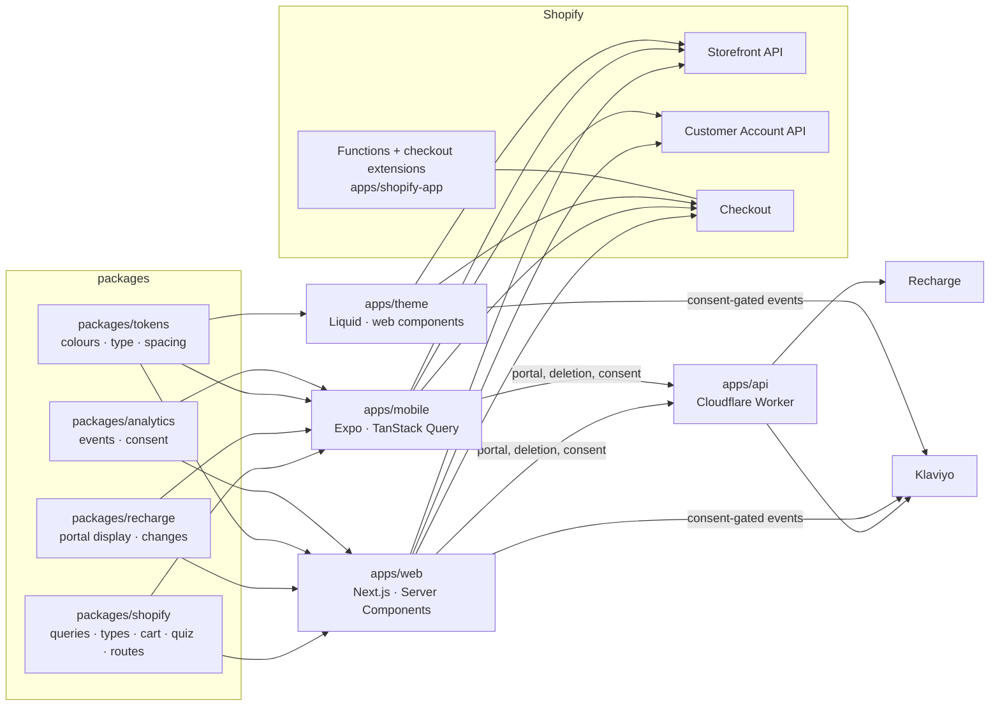

# Double Helix

**One Shopify Plus store, three storefronts, real subscriptions.** A Next.js
web app, an Expo React Native app and a Liquid theme sell the same supplement
subscriptions, from one Turborepo with a shared Storefront API layer, one set
of design tokens, and a Shopify app for checkout logic. It's a portfolio
project on a real development store, with checkout in test mode.

<!-- TODO (Ben): the live links once the domain (SHO-114) and TestFlight's public link exist. -->

- **Web:** [web-six-murex-18.vercel.app](https://web-six-murex-18.vercel.app)
  (production deploys from `main`)
- **App (iOS):** TestFlight; ask for an invite. <!-- TODO (Ben): public link -->
- **Theme:** the store is password-protected, as development stores are. The
  password is available on request.
- **Two-minute videos:** the shopping journey on all three surfaces, and the
  subscription portal. <!-- TODO (Ben): links, SHO-81 -->

| Web                                                                      | App                                                                                   | Theme                                                                      |
| ------------------------------------------------------------------------ | ------------------------------------------------------------------------------------- | -------------------------------------------------------------------------- |
|  |  |  |

## How it fits together



The two React apps share data code through `packages/shopify` and
`packages/recharge`. All three share design through `packages/tokens`. The
theme reads its data from Liquid rather than the shared client
([ADR 0005](docs/adr/0005-parity-means-design-not-data.md)). Anything that
needs a secret (Recharge's Admin key, Klaviyo's private key) lives only in the
Worker.

## Worth a closer look

- **Subscriptions end to end.** Subscribe-and-save on all three surfaces, and
  a portal on web and in the app where customers skip, pause, reschedule,
  change quantity and cancel (with save offers first, and cancelling never more
  than one page). Every change goes through the Worker, which checks the
  subscription belongs to the signed-in customer before touching it.
- **Subscription offers that stay true.** One-time against subscribe-and-save
  with the saving, price per day and renewal terms beside every button that
  buys; 60- and 90-day plans ship 60 and 90 days of product; carts offer to
  switch a line to a subscription. Each claim is one shared function with the
  UK and US rules written beside it.
- **Express checkout and free gifts.** Shop Pay and Apple Pay on all three
  surfaces (one-time only on product pages, renewal terms in every cart that
  holds a subscription), and free gifts as nested cart lines, set per product
  in Shopify and made free by a discount Function.
- **Checkout logic as Shopify Functions.** A cart limit (at most 6 of one
  product), a "build your stack" discount that leaves subscriptions and gifts
  alone, a free-gift discount, and checkout and thank-you panels that explain
  what happens next (`apps/shopify-app`).
- **A real billing bug, found and fixed.** Checkout promised free recurring
  delivery that renewals then charged for: the free-delivery threshold was
  judged on the first basket, and renewals are smaller. Fixed with a delivery
  profile for subscription plans, verified on a live renewal, and guarded by a
  script that catches new products' plans (SHO-99).
- **Design tokens on three runtimes.** One TypeScript source generates the CSS
  for Tailwind on web, NativeWind in the app and plain CSS in the theme.
- **Measured performance.** Lighthouse CI gates every web deployment and the
  theme, with budgets ratcheted to real numbers. Catalogue pages are cached
  and cleared by Shopify Events when a product changes.
- **Accessibility in CI on every surface.** axe (WCAG 2.2 AA) on web and a
  copy of the theme for each PR, keyboard paths tested end to end, and screen
  reader labels checked in the app's tests.
- **Privacy and compliance by design.** Nothing is tracked before consent,
  consent travels into checkout, and health claims follow a written guide to
  the GB register: the routine quiz asks about goals, never symptoms
  ([claims guide](docs/claims-wording.md)).

## How this was built

<!-- TODO (Ben): this section is a draft for you to rewrite in your own words. -->

I built this with an AI coding agent (Claude Code) doing most of the typing,
and I want to be upfront about it, because how the work was directed is part
of what this project shows.

- **My part:** the product and architecture decisions (recorded as
  [ADRs](docs/adr/README.md)), the privacy, legal and claims calls, reviewing
  every pull request before it merged, testing on real devices, and the store
  and third-party setup.
- **Guard rails on the agent:** branch protection with required CI; a second,
  automated reviewer (CodeRabbit) on every PR, whose findings were fixed
  before merging; new dependencies only once they're 7 days old (enforced by
  pnpm); secrets never in the repo or the chat; and written conventions in
  [`AGENTS.md`](AGENTS.md).
- **What went wrong, and what I learned:** <!-- TODO (Ben) -->

The full story, decisions and numbers are in the case study
<!-- TODO (Ben): link #71 once merged -->.

## Structure

```
apps/
  web/          Next.js 16 · App Router · Tailwind v4 · deploys to Vercel
  mobile/       Expo SDK 57 · Expo Router · NativeWind v5 · builds via EAS
  theme/        Liquid · web components · no build step · Shopify Online Store
  api/          Cloudflare Worker · subscription portal, account deletion, consent
  shopify-app/  Shopify app · Functions (cart limit, stack discount) · checkout extensions
packages/
  shopify/      Storefront API client, query documents, generated types, routes
  tokens/       Design tokens (TS source) → generated CSS for Tailwind and Liquid
  recharge/     Subscription display and portal changes, shared by web and app
  analytics/    Klaviyo event payloads and consent requests, shared by web and app
  eslint-config/
  typescript-config/
docs/           Architecture, domain model, decision records (also an Obsidian vault)
```

## Documentation

- [`docs/`](docs/README.md) — architecture, domain model, integration design
- [`docs/adr/`](docs/adr/README.md) — architecture decision records
- [`AGENTS.md`](AGENTS.md) — conventions and constraints, for humans and agents alike

## The one architectural rule

**`packages/shopify` must stay platform-neutral.** Both React apps import it, so
it uses bare `fetch` and has no Shopify runtime dependency — nothing
DOM-flavoured. Web-only ergonomics (`@shopify/hydrogen-react`'s `<Image>`) live
in `apps/web`.

`@shopify/hydrogen-react` _is_ a devDependency of `packages/shopify`, but only
for codegen: it ships the Storefront GraphQL schema as a local JSON file, so
type generation runs offline with no credentials and no network call.

The Liquid theme is the exception: it reads its data from Liquid, server-side,
and deliberately does not use `packages/shopify` at all. What all three share is
the design tokens — see
[ADR 0005](docs/adr/0005-parity-means-design-not-data.md).

## Data fetching differs by platform, deliberately

|               | Web                       | Native                  | Liquid theme        |
| ------------- | ------------------------- | ----------------------- | ------------------- |
| Fetching      | React Server Components   | TanStack Query          | Liquid, server-side |
| Token env var | `SHOPIFY_*` (server-only) | `EXPO_PUBLIC_SHOPIFY_*` | none needed         |

The web app never sends its token to the browser because every query runs on the
server. The Expo bundle _is_ the client, so its token ships with the app — which
is exactly what a public Storefront access token is designed for.

⚠️ The Admin API token must never appear in any package. Anything Admin-flavoured
belongs behind a Next.js route handler.

## Setup

You need Node 22 or later and pnpm 11. The repository pins its pnpm version
(`packageManager` in `package.json`), so `corepack enable` provides the right
one. Node 25 and later no longer include Corepack, so install it first there.

```bash
npm install --global corepack   # Node 25 and later only
corepack enable
pnpm install
```

Create a Storefront access token (Shopify admin → add the **Headless** sales
channel → create a storefront → publish products to it), then:

```bash
cp apps/web/.env.example apps/web/.env.local
cp apps/mobile/.env.example apps/mobile/.env.local
```

Fill in `SHOPIFY_STORE_DOMAIN` and `SHOPIFY_STOREFRONT_TOKEN` in the first, and
the same values under their `EXPO_PUBLIC_` names in the second. Each example
file says what every variable is for. Both copies are gitignored; this
repository is public. The theme and the API worker have their own examples
(`apps/theme/.env.local.example`, `apps/api/.dev.vars.example`).

Confirm the credential works before starting either app:

```bash
pnpm --filter @formulate/shopify smoke
```

## Commands

```bash
pnpm web          # Next.js dev server on :3000
pnpm mobile       # Expo dev server
pnpm lint         # ESLint across the workspace
pnpm typecheck    # tsc --noEmit across the workspace
pnpm build        # Next build + Expo export
pnpm codegen      # Regenerate Storefront types from the query documents
```

After editing `packages/shopify/src/queries.ts`, run `pnpm codegen` and commit
the result — CI fails if the generated output has drifted.

After editing `packages/tokens/src/tokens.ts`, run
`pnpm --filter @formulate/tokens build` to regenerate `theme.css`. Never edit
that file by hand.

## Known version constraints

These are load-bearing. Read the comments before changing them.

- **`lightningcss` is pinned to `1.30.1`** in `pnpm-workspace.yaml`. NativeWind v5
  deserialises lightningcss output in `react-native-css`, and any newer version
  fails at Metro bundle time — never at install time.
- **TypeScript is pinned to `~6.0.3`, not 7.** No `typescript-eslint` release
  supports TypeScript 7 (all cap at `<6.1.0`), and its parser is what lets
  ESLint read TypeScript at all. 6.0.3 is the sweet spot: inside that range and
  exactly what Expo SDK 57 expects. Note TS 6 deprecates `baseUrl`, so the app
  tsconfigs use `paths` alone.
- **React is pinned to `19.2.3` workspace-wide** via a pnpm override, because
  that is the version Expo SDK 57 expects. Under the hoisted node linker a
  second React copy would break hooks in the Expo app.
- **React version is declared explicitly** in `packages/eslint-config/react-native.js`.
  `eslint-plugin-react` 7.37.x crashes on ESLint 10 during version _detection_.
- **NativeWind v5 is pre-release** (`5.0.0-preview.4`), chosen so both apps share
  one Tailwind v4 token file. The fallback is NativeWind v4 + Tailwind v3 in
  `apps/mobile` only.
