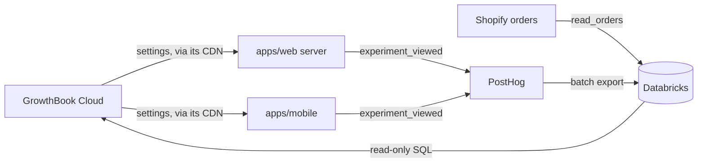

# Integration: GrowthBook

A/B tests on web and the app, analysed in Databricks. The reasoning is in
[ADR 0013](adr/0013-experiments-run-on-growthbook-for-consenting-visitors.md);
this note says how the pieces connect and how to set them up.

## How it fits together



1. **Assignment.** Each surface asks `packages/experiments` for a visitor's
   variant. The visitor id is PostHog's anonymous id, which exists only after
   the shopper accepts tracking. Without it everyone sees the control.
2. **Exposure.** The surface sends `experiment_viewed` to PostHog, with
   GrowthBook's experiment tracking key and the variation's key.
3. **Outcome.** The order carries the same id in its `_posthog_id` cart
   attribute (#108).
4. **Analysis.** PostHog's batch export lands events in Databricks;
   `apps/warehouse` copies what it needs out of them and loads the orders,
   every morning. GrowthBook queries the views it creates.

## Setting up GrowthBook

| What                 | Where                                                                                                                                     |
| -------------------- | ----------------------------------------------------------------------------------------------------------------------------------------- |
| SDK connections      | One per surface, in the `production` environment: web (Node.js) and, when the app's change lands, mobile (React Native)                   |
| Web key              | `GROWTHBOOK_CLIENT_KEY` on Vercel, Production only. Not `NEXT_PUBLIC_`                                                                    |
| App key              | `EXPO_PUBLIC_GROWTHBOOK_CLIENT_KEY` in EAS, when the app's change lands                                                                   |
| An experiment        | A **feature** whose key is in `packages/experiments`, with an **experiment rule** whose variation values are that experiment's `variants` |
| Assignment attribute | `id`, hashed with GrowthBook's v2 hashing                                                                                                 |

**Previews have no key, on purpose.** Without one, a preview always shows the
control and sends no exposures, so reviewers' visits never reach the results.
A `dev` environment wouldn't stop that: its exposures would go to the same
PostHog project under the same experiment key. Add one later if rule changes
need trying out before production.

To look at a variant without being counted, on a preview or in production,
add the experiment's key and a variant name to the page's query string:
`?product-page-aa=control-copy`. It works without a key.

## Connecting PostHog

PostHog sends events to Databricks with its **batch export**, the route it
supports for a regular copy (its query API is for ad-hoc questions, not
exports). The export lands whole events; `apps/warehouse` keeps only the
columns it lists and deletes the rest the same morning.

1. **In PostHog, first** (project **Settings**): turn on **Discard client IP
   data**, and turn off the **GeoIP** transformation under **Data pipelines**.
   Then no IP address or location is in an event to begin with.
2. **In Databricks**, add a service principal called `posthog-exporter`
   (**Settings → Identity and access → Service principals**). On its
   **Secrets** tab, generate an OAuth secret; note the client id and the
   secret, which is shown once. Give it **Can use** on the SQL warehouse, and
   grant:

   ```sql
   GRANT USE CATALOG ON CATALOG workspace TO `posthog-exporter`;
   GRANT USE SCHEMA ON SCHEMA workspace.double_helix TO `posthog-exporter`;
   GRANT CREATE TABLE ON SCHEMA workspace.double_helix TO `posthog-exporter`;
   GRANT CREATE VOLUME ON SCHEMA workspace.double_helix TO `posthog-exporter`;
   ```

   Run `src/setup.py` once before this, so the schema exists.

3. **In PostHog**, **Data pipelines → Destinations → New → Databricks**:

   | Field            | Value                                                  |
   | ---------------- | ------------------------------------------------------ |
   | Integration      | Server hostname, and the client id and secret from 2   |
   | HTTP path        | From the SQL warehouse's **Connection details**        |
   | Catalog / schema | `workspace` / `double_helix`                           |
   | Table name       | `posthog_events_landing` (PostHog creates it)          |
   | Model            | Events                                                 |
   | Interval         | Daily                                                  |
   | Use VARIANT type | On (the default): the loader reads `properties` as one |

4. **Backfill** from the destination's page, for the days before it was
   created. The next morning's job copies them in.

Check PostHog's billing page for what the export costs on the current plan
before turning it on.

## Connecting Databricks

In GrowthBook, **Metrics and Data → Data Sources → Add**, type **Databricks**:

| Field     | Value                                                         |
| --------- | ------------------------------------------------------------- |
| Host      | The workspace host, without `https://`                        |
| Port      | 443                                                           |
| HTTP path | From the SQL warehouse's **Connection details**               |
| Token     | A token for the `growthbook-reader` service principal (below) |
| Catalog   | `workspace`                                                   |

Identifier type: `user_id`.

**The token reads the two views and nothing else.** The tables under them hold
browsing details and customer hashes the views leave out, and the landing
table holds whole events, so GrowthBook gets no grant on the schema as a
whole. In Databricks, add a service principal
called `growthbook-reader` (**Settings → Identity and access → Service
principals**), give it **Can use** on the SQL warehouse, and grant it this in
the SQL editor:

```sql
GRANT USE CATALOG ON CATALOG workspace TO `growthbook-reader`;
GRANT USE SCHEMA ON SCHEMA workspace.double_helix TO `growthbook-reader`;
GRANT SELECT ON TABLE workspace.double_helix.experiment_exposures TO `growthbook-reader`;
GRANT SELECT ON TABLE workspace.double_helix.attributed_orders TO `growthbook-reader`;
```

`ON TABLE` covers views. A view runs with its owner's rights, so the
principal can read the views without being able to read `posthog_events`,
`orders` or `order_lines`. Make its token with
`databricks token-management create-obo-token <application-id>`, which prints
it once: paste it straight into GrowthBook.

**Experiment assignment query:**

```sql
SELECT user_id, timestamp, experiment_id, variation_id
FROM workspace.double_helix.experiment_exposures
WHERE timestamp BETWEEN '{{startDate}}' AND '{{endDate}}'
```

## Metrics

Each is a **fact table** or **SQL metric** on `attributed_orders`, with
`user_id` as the identifier. On the demo store every order is a test order,
so the `test` column is kept and not filtered; a real store adds
`AND NOT test`.

| Metric                 | Type       | SQL                                                                                         |
| ---------------------- | ---------- | ------------------------------------------------------------------------------------------- |
| Placed an order        | Proportion | `SELECT user_id, timestamp FROM workspace.double_helix.attributed_orders`                   |
| Revenue per visitor    | Mean       | `SELECT user_id, timestamp, revenue AS value FROM workspace.double_helix.attributed_orders` |
| Ordered a subscription | Proportion | `... FROM workspace.double_helix.attributed_orders WHERE has_subscription`                  |

Revenue is in each order's own currency. The demo store sells in GBP only; a
second currency would need converting first.

## What to check before trusting a result

- **The A/A test first.** Both arms render the same page. A sample ratio
  mismatch means the pipeline is wrong, not the page: assignment or exposure
  is losing visitors from one arm. A significant difference in a metric is a
  reason to look, not proof of a fault, since an A/A test shows one by
  chance about one time in twenty. Check the pipeline, and if it's sound,
  run the test again before trusting a real one.
- **Orders without `_posthog_id`** can't be attributed: those from shoppers
  who didn't accept tracking, from the theme, and any placed before the cart
  attribute (#108) went live.
- **Only visitors who accept tracking take part**, so results describe them,
  not every shopper.

## Related

- [ADR 0013](adr/0013-experiments-run-on-growthbook-for-consenting-visitors.md) ·
  [ADR 0008](adr/0008-headless-tracking-consent-is-our-own.md)
- `apps/warehouse/AGENTS.md`: the loaders, their secrets and their privacy rules
